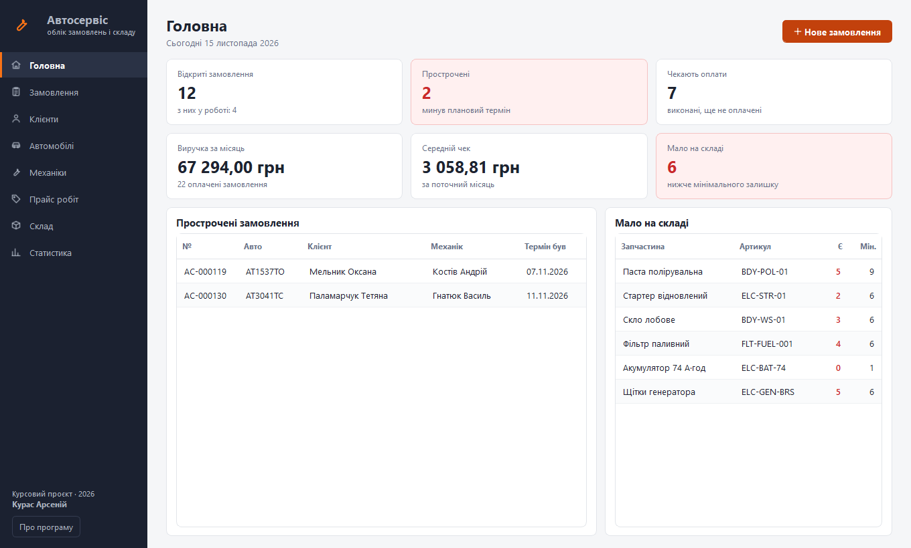

# Автосервіс

Настільний застосунок для майстра-приймальника автосервісу: клієнти та їхні автомобілі, замовлення-наряди
на ремонт (роботи й запчастини), склад запчастин, механіки, прайс робіт і статистика.

Курсовий проєкт з дисципліни «Об'єктно-орієнтоване програмування», тема 3 «Розробка програмного додатку для
роботи з базою даних предметної області „Автосервіс“».
Виконав **Курас Арсеній Володимирович**, ВСП «Фаховий коледж електронних приладів ІФНТУНГ», 2026.



## Можливості

- **Замовлення-наряд**: клієнт → його авто → вільний механік. В одного авто може бути лише одне відкрите
  замовлення, у механіка — не більше чотирьох.
- **Роботи й запчастини** з ціною, зафіксованою в момент додавання. Запчастина одразу списується зі складу
  в одній транзакції; більше, ніж є на складі, списати не можна.
- **Статуси** «Нове → В роботі → Виконано → Оплачено» або «Скасовано» з перевіркою дозволених переходів
  (патерн «Стан»). Завершення оновлює пробіг авто, скасування повертає запчастини на склад, кожна зміна
  потрапляє в історію.
- **Знижки**: ручна знижка майстра до 30 % і 5 % на роботи для постійного клієнта (від 5 оплачених
  замовлень); з двох знижок діє більша.
- **Пошук** за кількома полями (кирилиця без урахування регістру), **фільтри** (3–4 умови одночасно),
  **сортування** за двома полями з напрямком, кнопка «Скинути».
- **Експорт** будь-якої таблиці з урахуванням фільтрів у CSV (для Excel) або JSON; **імпорт** накладної
  постачальника (прихід запчастин) із CSV з перевіркою структури, значень і дублікатів.
- **Головна сторінка** з показниками дня та **статистика** з графіками Matplotlib: виручка по місяцях,
  топ робіт, завантаженість механіків.

## Вимоги

| Компонент | Версія |
|---|---|
| Операційна система | Windows 10 або 11 (перевірено на Windows 10 Pro 22H2) |
| Python | 3.12 або новіший (перевірено на 3.14.2) |
| Бібліотеки | `requirements.txt`: PyQt5 5.15.11, Matplotlib 3.11.2 |

SQLite входить до Python (модуль `sqlite3`). Python 3.12+ потрібен через параметр `autocommit` модуля `sqlite3`.

## Встановлення

```bash
git clone https://github.com/arseniikuras-is2401-afk/Cursova.git
```

```bash
cd Cursova
```

```bash
python -m venv .venv
```

```bash
.venv\Scripts\activate
```

```bash
python -m pip install -r requirements.txt
```

## Запуск

```bash
python main.py
```

Під час **першого запуску** створюється база `data/autoservice.db` і заповнюється демонстраційними даними:
30 клієнтів, 40 авто, 6 механіків (1 неактивний), 8 категорій, 35 робіт, 31 запчастина, 150 замовлень за
останні пів року в усіх статусах. Наступні запуски наявних даних не змінюють і не дублюють.

**Скинути демонстраційну базу**: закрийте програму, видаліть `data/autoservice.db` і запустіть знову.

## Користування

| Завдання | Де і як |
|---|---|
| Оформити замовлення | Кнопка «Нове замовлення» (Ctrl+N) або «Клієнти»/«Автомобілі» → вибрати авто → «Нове замовлення» |
| Додати роботу чи запчастину | Відкрити замовлення (подвійне клацання) → вкладка «Роботи» / «Запчастини» → «Додати» |
| Змінити статус | У вікні замовлення: «Почати роботу», «Завершити», «Прийняти оплату», «Скасувати замовлення» |
| Додати клієнта й авто | «Клієнти» → «Новий клієнт»; авто — у нижній панелі «Автомобілі клієнта» |
| Прихід запчастин | «Склад» → вибрати запчастину → «Прихід» або «Імпорт накладної» (CSV) |
| Експорт | Кнопка «Експорт» під таблицею → CSV або JSON |
| Механіки | «Механіки» → «Деактивувати» (доступно, коли немає відкритих замовлень) |
| Графіки | «Статистика» → період і механік |
| Про програму | Кнопка внизу бічної панелі |

Неактивна кнопка означає, що дія зараз недоступна; причину показує підказка. Ctrl+1…8 — перехід між
розділами, Delete — видалити виділений запис (з підтвердженням), Enter — відкрити.

### Формат накладної для імпорту

UTF-8 або Windows-1251, роздільник `;`, `,` або табуляція. Заголовки англійською або українською:

```text
Артикул;Назва;Категорія;Ціна;Кількість;Мінімальний залишок
BRK-PAD-F01;Колодки гальмівні передні;Гальмівна система;1250,00;8;4
OIL-5W30-4L;Олива моторна 5W-30, 4 л;ТО та мастила;1480;12;
```

Наявний артикул поповнюється (кількість додається, ціна оновлюється), новий створюється. Категорія має
бути в довіднику. Рядки з помилками пропускаються, програма показує їхні номери.

## Структура проєкту

```
main.py                 точка входу
config.py               шляхи, константи правил, дані про автора
models/                 предметна область: Money, Client, Employee, Car, WorkType, Part,
                        Order, рядки замовлення, знижки, статуси (патерн «Стан»), перевірки
database/               з'єднання, схема (10 таблиць, 7 представлень), Unit of Work,
                        DAO таблиць, ListQuery (пошук/фільтри/сортування), демо-дані
services/               сценарії й транзакції, події EventHub, звіти, імпорт і експорт
ui/                     головне вікно, сторінки, вікно замовлення, форми, фільтри, графіки
resources/              стилі QSS і піктограми
docs/                   аналіз, проєктування, діаграми, скриншоти,
                        пояснювальна записка й презентація
tools/                  render_diagrams.py — PNG діаграм з .mmd (потрібен Google Chrome);
                        build_note.js, note_content.js, assemble_note.ps1 — пояснювальна
                        записка (потрібні npm-пакет docx, Microsoft Word і шаблони
                        викладача в build/templates); build_deck.js — презентація
```

## Документація

- [Пояснювальна записка (.docx)](docs/Курас_ПЗ.docx),
  [PDF](docs/Курас_ПЗ.pdf)
- [Презентація (.pptx)](docs/Презентація_Курас_Автосервіс.pptx)
- [Аналіз предметної області](docs/01_analysis.md)
- [Проєктування: база даних, класи, інтерфейс](docs/02_design.md)
- Діаграми (вихідні `.mmd` і зображення `.png`): `docs/diagrams/`
