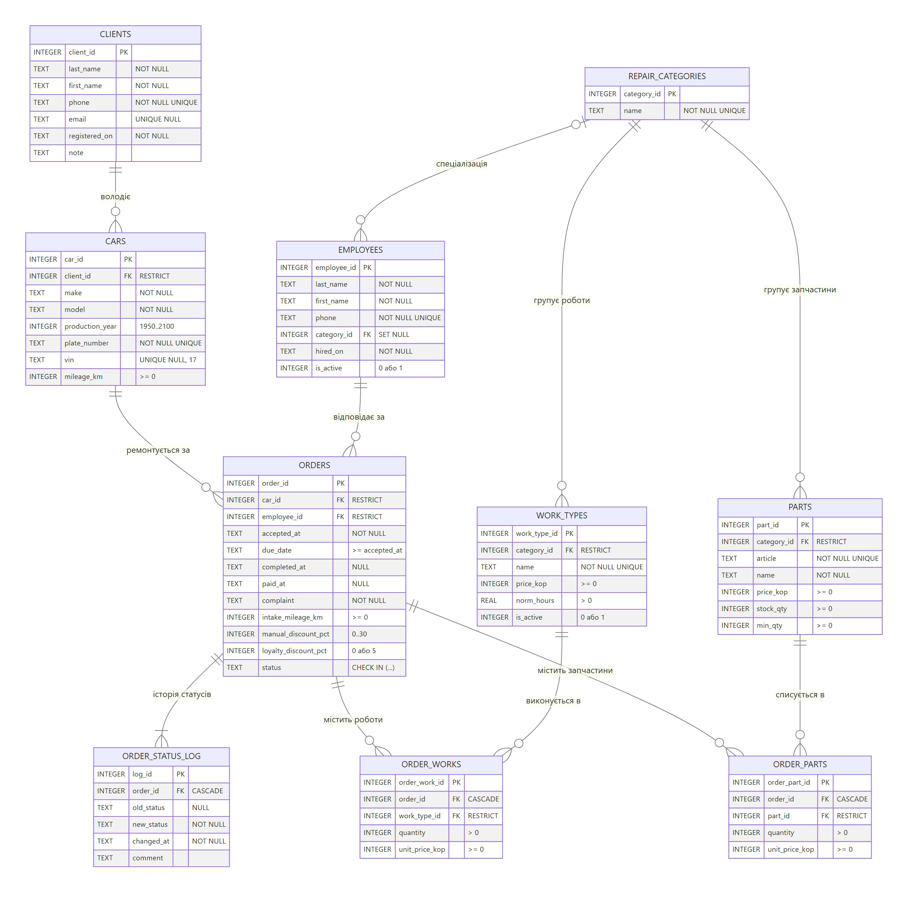
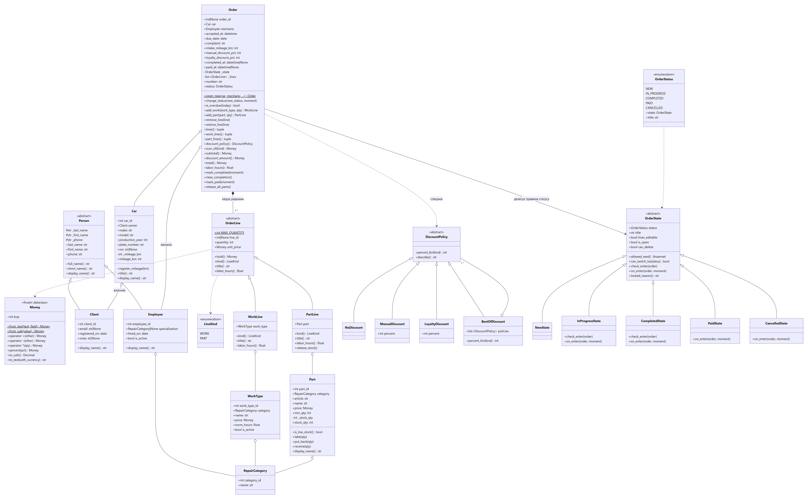
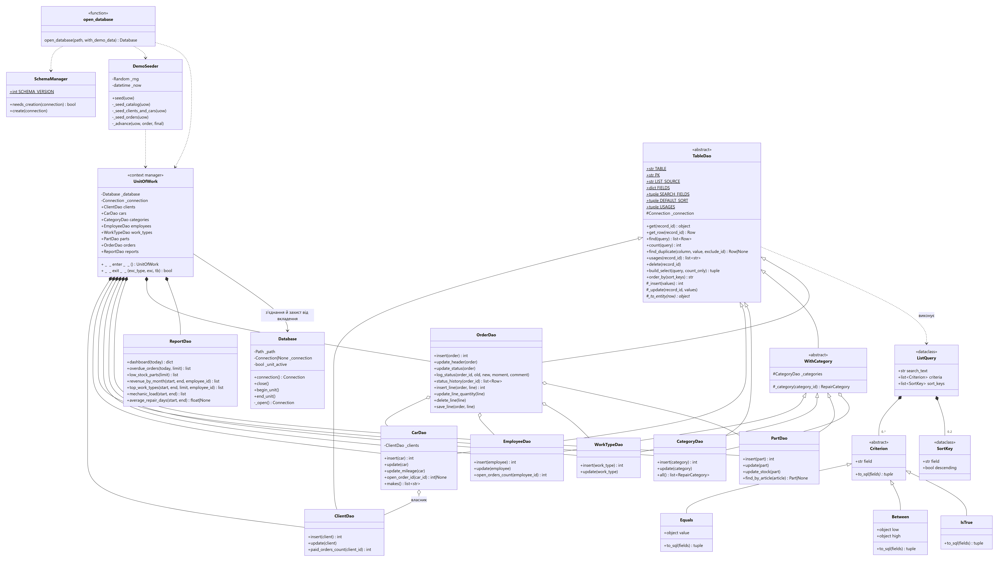
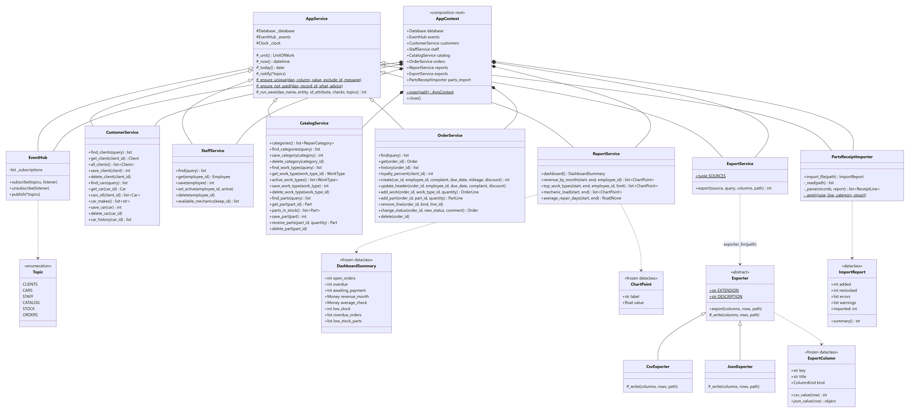
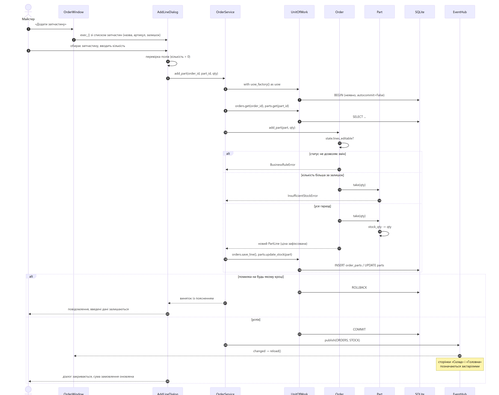
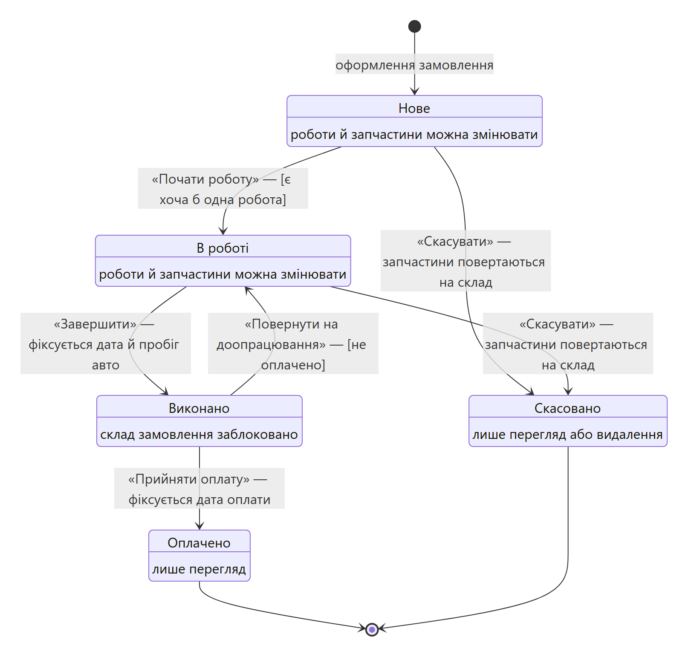
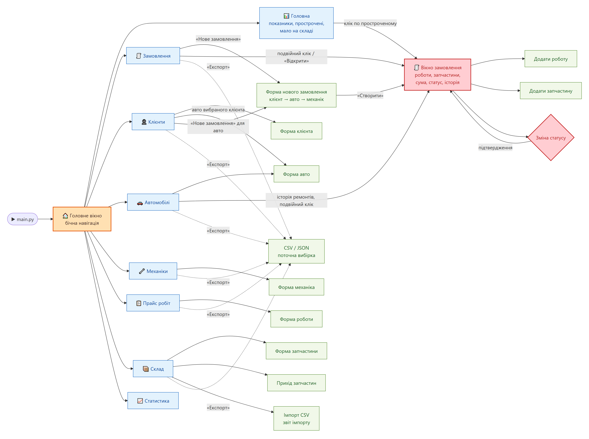
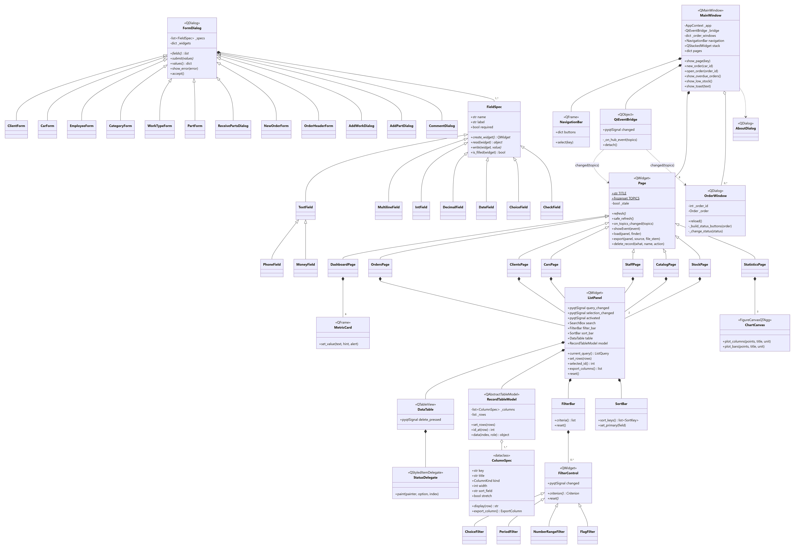

# Етап 2. Проєктування програмного забезпечення

Документ описує рішення щодо бази даних, класів і графічного інтерфейсу застосунку «Автосервіс». Він є
основою розділу 2 «Конструкторська частина» пояснювальної записки. Вихідні тексти діаграм лежать у
`docs/diagrams/*.mmd`, зображення — поруч у `.png`.

Ключові рішення одним списком:

| Рішення | Чому саме так |
|---|---|
| Гроші зберігаються цілими числами в копійках (`*_kop`), у коді — клас `Money` | `REAL` дає похибки округлення (0,1 + 0,2 ≠ 0,3), а сума замовлення має сходитися до копійки |
| Ціна в рядку замовлення фіксується в момент додавання | Зміна прайсу не повинна переписувати суми старих замовлень |
| Знижки зберігаються в замовленні як відсотки, а суми рахує представлення `v_order_list` | Немає дубльованої «суми» в таблиці, яку треба синхронізувати; при цьому знижка постійного клієнта не змінюється заднім числом |
| Статуси замовлення — патерн «Стан» (`OrderState`) | Кожен статус сам знає, які переходи дозволені й що відбувається при вході в нього; немає великих `if/elif` у сервісі |
| Транзакції — патерн Unit of Work | Одна дія користувача = один блок `with`; або всі зміни збережено, або жодної |
| Пошук, фільтри й сортування — об'єкт `ListQuery` з поліморфними умовами | Один механізм для всіх таблиць, назви стовпців беруться лише з білого списку |
| Сервіси не залежать від Qt; сторінки отримують події через міст `QtEventBridge` | Правила предметної області не змішуються з кодом вікон |
| Форми описуються декларативно списком полів (`FieldSpec`) | Однакова перевірка й підсвічування помилок у всіх діалогах без копіювання коду |

---

## 2.1 Проєктування бази даних

СКБД — SQLite 3 (модуль `sqlite3` зі стандартної бібліотеки Python). Файл бази: `data/autoservice.db`.
Дати зберігаються як текст ISO 8601: дата `YYYY-MM-DD`, дата й час `YYYY-MM-DD HH:MM`. Так SQLite
коректно порівнює й сортує їх як рядки, і з ними працюють функції `date()` / `strftime()`.

### ER-діаграма



10 таблиць: 6 довідникових/облікових (`clients`, `cars`, `employees`, `repair_categories`, `work_types`,
`parts`) і 4 для замовлень (`orders`, `order_works`, `order_parts`, `order_status_log`).

### Таблиця `clients` — клієнти

| Поле | Тип | Обмеження | Пояснення |
|---|---|---|---|
| `client_id` | INTEGER | PK | |
| `last_name` | TEXT | NOT NULL, CHECK (довжина 2–50) | |
| `first_name` | TEXT | NOT NULL, CHECK (довжина 2–50) | |
| `phone` | TEXT | NOT NULL, UNIQUE | Зберігається нормалізованим: `0XXXXXXXXX` |
| `email` | TEXT | UNIQUE, може бути NULL | Порожній рядок перетворюється на NULL, щоб UNIQUE не спрацьовував на порожніх |
| `registered_on` | TEXT | NOT NULL, CHECK (`date(registered_on) IS NOT NULL`) | |
| `note` | TEXT | | Довільна примітка майстра |

### Таблиця `cars` — автомобілі

| Поле | Тип | Обмеження | Пояснення |
|---|---|---|---|
| `car_id` | INTEGER | PK | |
| `client_id` | INTEGER | NOT NULL, FK → `clients`, ON DELETE RESTRICT | Власник |
| `make`, `model` | TEXT | NOT NULL | Марка, модель |
| `production_year` | INTEGER | CHECK (1950–2100) | Верхню межу (поточний рік + 1) перевіряє модель |
| `plate_number` | TEXT | NOT NULL, UNIQUE | Формат `AA1234BB`, латиницею у верхньому регістрі |
| `vin` | TEXT | UNIQUE, може бути NULL, CHECK (довжина 17) | Без літер I, O, Q |
| `mileage_km` | INTEGER | NOT NULL, CHECK (≥ 0) | Останній відомий пробіг |

### Таблиця `employees` — механіки

| Поле | Тип | Обмеження | Пояснення |
|---|---|---|---|
| `employee_id` | INTEGER | PK | |
| `last_name`, `first_name` | TEXT | NOT NULL | |
| `phone` | TEXT | NOT NULL, UNIQUE | |
| `category_id` | INTEGER | FK → `repair_categories`, ON DELETE SET NULL | Спеціалізація; необов'язкова |
| `hired_on` | TEXT | NOT NULL | |
| `is_active` | INTEGER | NOT NULL, DEFAULT 1, CHECK (0, 1) | Звільненого механіка не видаляють, а деактивують |

### Таблиця `repair_categories` — вузли / категорії ремонту

| Поле | Тип | Обмеження |
|---|---|---|
| `category_id` | INTEGER | PK |
| `name` | TEXT | NOT NULL, UNIQUE |

Приклади: «Двигун», «Ходова частина», «Гальмівна система», «Електрика», «ТО та мастила», «Кузов»,
«Шиномонтаж», «Діагностика». Одна категорія групує і роботи, і запчастини. Завдяки цьому у вікні
замовлення при додаванні запчастини першими показуються деталі тих категорій, роботи з яких уже є в
замовленні.

### Таблиця `work_types` — прайс робіт

| Поле | Тип | Обмеження | Пояснення |
|---|---|---|---|
| `work_type_id` | INTEGER | PK | |
| `category_id` | INTEGER | NOT NULL, FK → `repair_categories`, ON DELETE RESTRICT | |
| `name` | TEXT | NOT NULL, UNIQUE | |
| `price_kop` | INTEGER | NOT NULL, CHECK (≥ 0) | Ціна за одиницю, коп. |
| `norm_hours` | REAL | NOT NULL, CHECK (> 0) | Нормо-години на одиницю; потрібні для завантаженості механіків |
| `is_active` | INTEGER | NOT NULL, DEFAULT 1, CHECK (0, 1) | Неактивну роботу не можна додати до нового замовлення |

### Таблиця `parts` — склад запчастин

| Поле | Тип | Обмеження | Пояснення |
|---|---|---|---|
| `part_id` | INTEGER | PK | |
| `category_id` | INTEGER | NOT NULL, FK → `repair_categories`, ON DELETE RESTRICT | |
| `article` | TEXT | NOT NULL, UNIQUE | Артикул; ключ для пошуку дублікатів під час імпорту |
| `name` | TEXT | NOT NULL | |
| `price_kop` | INTEGER | NOT NULL, CHECK (≥ 0) | Ціна продажу |
| `stock_qty` | INTEGER | NOT NULL, CHECK (≥ 0) | Залишок. CHECK — остання лінія захисту від від'ємного залишку |
| `min_qty` | INTEGER | NOT NULL, DEFAULT 0, CHECK (≥ 0) | Нижче цього рівня запчастина підсвічується |

### Таблиця `orders` — замовлення-наряди

| Поле | Тип | Обмеження | Пояснення |
|---|---|---|---|
| `order_id` | INTEGER | PK | В інтерфейсі показується як «АС-000041» |
| `car_id` | INTEGER | NOT NULL, FK → `cars`, ON DELETE RESTRICT | Клієнт визначається через авто, окремого `client_id` немає, щоб не дублювати зв'язок |
| `employee_id` | INTEGER | NOT NULL, FK → `employees`, ON DELETE RESTRICT | Відповідальний механік |
| `accepted_at` | TEXT | NOT NULL | Дата й час приймання |
| `due_date` | TEXT | NOT NULL, CHECK (`due_date >= date(accepted_at)`) | Плановий термін |
| `completed_at` | TEXT | NULL | Заповнюється при переході у «Виконано» |
| `paid_at` | TEXT | NULL | Заповнюється при оплаті |
| `complaint` | TEXT | NOT NULL | Скарга клієнта / що зробити |
| `intake_mileage_km` | INTEGER | NOT NULL, CHECK (≥ 0) | Пробіг при прийманні |
| `manual_discount_pct` | INTEGER | NOT NULL, DEFAULT 0, CHECK (0–30) | Ручна знижка майстра |
| `loyalty_discount_pct` | INTEGER | NOT NULL, DEFAULT 0, CHECK (0, 5) | Знижка постійного клієнта, визначається під час створення замовлення |
| `status` | TEXT | NOT NULL, CHECK IN (`new`, `in_progress`, `completed`, `paid`, `cancelled`) | |

Додаткові табличні CHECK, які узгоджують статус і дати:
- `paid_at IS NULL OR status = 'paid'`;
- `status NOT IN ('completed', 'paid') OR completed_at IS NOT NULL`.

### Таблиці `order_works` і `order_parts` — рядки замовлення

| Поле | Тип | Обмеження | Пояснення |
|---|---|---|---|
| `order_work_id` / `order_part_id` | INTEGER | PK | |
| `order_id` | INTEGER | NOT NULL, FK → `orders`, ON DELETE CASCADE | Рядки не існують без замовлення |
| `work_type_id` / `part_id` | INTEGER | NOT NULL, FK, ON DELETE RESTRICT | |
| `quantity` | INTEGER | NOT NULL, CHECK (> 0) | |
| `unit_price_kop` | INTEGER | NOT NULL, CHECK (≥ 0) | Ціна на момент додавання |

Для `order_parts` діє UNIQUE(`order_id`, `part_id`): повторне додавання тієї ж запчастини збільшує
кількість в наявному рядку, а не створює новий. Для робіт такого обмеження немає: одну роботу можна
вказати двічі з різними цінами (наприклад, після зміни прайсу).

### Таблиця `order_status_log` — історія статусів

| Поле | Тип | Обмеження | Пояснення |
|---|---|---|---|
| `log_id` | INTEGER | PK | |
| `order_id` | INTEGER | NOT NULL, FK → `orders`, ON DELETE CASCADE | |
| `old_status` | TEXT | NULL | NULL для першого запису (створення) |
| `new_status` | TEXT | NOT NULL | |
| `changed_at` | TEXT | NOT NULL | |
| `comment` | TEXT | | Наприклад, причина повернення на доопрацювання |

Навіщо окрема таблиця: майстру потрібно бачити, коли авто почали ремонтувати й скільки разів
повертали на доопрацювання. З неї ж рахується середня тривалість ремонту в статистиці. Поля дат у
`orders` зберігають лише поточний стан і цієї історії не дають.

### Представлення (VIEW)

| Представлення | Призначення |
|---|---|
| `v_order_list` | Замовлення з держномером, авто, ПІБ і телефоном клієнта, механіком, сумами робіт і запчастин, знижкою, підсумком і ознакою `is_overdue`. Використовується таблицею «Замовлення», експортом і статистикою |
| `v_client_list` | Клієнти з кількістю авто й оплачених замовлень, ознаками «є відкрите замовлення» і «постійний клієнт» |
| `v_car_list` | Авто з власником, кількістю замовлень і датою останнього візиту |
| `v_employee_list` | Механіки з назвою спеціалізації та кількістю відкритих і всіх замовлень |
| `v_work_type_list` | Прайс робіт з назвою категорії й кількістю використань |
| `v_part_list` | Запчастини з назвою категорії й ознакою `is_low` (`stock_qty < min_qty`) |
| `v_category_list` | Категорії з кількістю робіт і запчастин |

Представлення лише читають дані, тож обчислювані стовпці (кількості, ознаки, суми) не зберігаються
в таблицях і не можуть розійтися з реальними записами.

Сума в `v_order_list` рахується так само, як `Order.total()` у Python, з однаковим округленням
(половина копійки — вгору):

```
works_discount = (works_kop * MAX(manual_pct, loyalty_pct) + 50) / 100   -- цілочисельне ділення
parts_discount = (parts_kop * manual_pct + 50) / 100
total_kop      = works_kop - works_discount + parts_kop - parts_discount
```

Знижка постійного клієнта діє лише на роботи, ручна — на роботи й запчастини; з двох знижок на роботи
застосовується більша, вони не додаються.

### Індекси

`cars(client_id)`, `orders(car_id)`, `orders(employee_id)`, `orders(status)`, `orders(accepted_at)`,
`order_works(order_id)`, `order_parts(order_id)`, `order_status_log(order_id)`. UNIQUE-обмеження
створюють власні індекси автоматично.

### Правила видалення пов'язаних записів

| Що видаляємо | Правило | Як поводиться програма |
|---|---|---|
| Клієнт з авто | RESTRICT | Кнопка «Видалити» активна, але після підтвердження показується: «У клієнта 2 авто. Спочатку видаліть або передайте їх іншому власнику» |
| Авто із замовленнями | RESTRICT | Історію ремонтів не можна втратити; пояснення з кількістю замовлень |
| Механік у замовленнях | RESTRICT | Пропонується деактивувати замість видалення |
| Категорія з роботами / запчастинами | RESTRICT | Пояснення, скільки записів її використовують |
| Робота / запчастина в замовленнях | RESTRICT | Робота — деактивувати; запчастину — лишити з нульовим залишком |
| Категорія — спеціалізація механіка | SET NULL | Механік лишається без спеціалізації |
| Замовлення `new` або `cancelled` | CASCADE для рядків і історії | Для `new` запчастини повертаються на склад у тій самій транзакції; замовлення в інших статусах видалити не можна |

Обмеження бази (FK, CHECK, UNIQUE) — друга лінія захисту. Перша — перевірки в моделях і сервісах, які
дають зрозуміле повідомлення ще до запиту. Якщо запит усе ж порушить обмеження, `sqlite3.IntegrityError`
перехоплюється й перекладається на повідомлення українською.

### Транзакції та з'єднання

- Застосунок тримає одне з'єднання на весь час роботи; його створює й закриває `Database`.
- `PRAGMA foreign_keys = ON` виконується одразу після підключення в режимі `autocommit=True`, бо всередині
  відкритої транзакції ця команда не діє. Після цього з'єднання переводиться в `autocommit=False`
  (Python 3.12+), і кожна операція виконується в явній транзакції.
- Межі транзакції задає `UnitOfWork`: вихід із блоку `with` без винятку — `commit()`, з винятком —
  `rollback()`. DAO-класи ніколи не викликають `commit()` самі.
- `Database` не дозволяє відкрити одну `UnitOfWork` всередині іншої: вкладена одиниця підтвердила б
  частину зовнішньої операції.
- `sqlite3.IntegrityError` перекладається в `UnitOfWork` на винятки предметної області з українським
  текстом (наприклад, порушення `UNIQUE(cars.plate_number)` → «Авто з таким держномером уже є в базі»).

### Створення схеми й демонстраційні дані

- Версія схеми зберігається в `PRAGMA user_version`. Функція `open_database()` перевіряє її
  (`SchemaManager.needs_creation()`): якщо 0 — база нова, і в **одній транзакції** створюються таблиці,
  індекси, представлення, записуються демо-дані та `user_version = 1`. Якщо заповнення перерветься,
  відкотиться все, і наступний запуск почне спочатку. Якщо версія 1 — нічого не змінюється, тож повторний
  запуск не видаляє даних і не дублює демо-записи.
- Демо-замовлення створюються тими самими методами моделей, що й у програмі (`Order.open_new()`,
  `add_part()`, `change_status()`), тому вони відповідають усім правилам: склад не стає від'ємним, в авто
  не більше одного відкритого замовлення, у механіка — не більше чотирьох.
- Демо-дані генеруються з фіксованим зерном випадкових чисел, тому на кожному комп'ютері виходить однаковий
  набір (дати відраховуються від дня першого запуску): 8 категорій, 35 робіт (1 неактивна), 31 запчастина
  (кілька нижче мінімуму), 6 механіків (1 неактивний), 30 клієнтів, 40 авто, 150 замовлень за останні
  6 місяців у всіх статусах, включно з простроченими, та історія статусів до кожного з них.
- Скидання: видалити `data/autoservice.db` і запустити програму.

---

## 2.2 Проєктування класів та їх взаємодії

### Шари

```
ui/        PyQt5: вікна, сторінки, діалоги, моделі таблиць        ← знає про services і models
services/  сценарії, правила, транзакції, події, імпорт/експорт   ← знає про database і models
database/  з'єднання, схема, Unit of Work, DAO, ListQuery         ← знає про models
models/    об'єкти предметної області, валідація, гроші, статуси  ← ні від кого не залежить
```

Залежності йдуть лише вниз. `models/` і `services/` не імпортують PyQt5, тому правила предметної
області не залежать від інтерфейсу.

### Класи предметної області (`models/`)



| Клас | Відповідальність |
|---|---|
| `Money` | Незмінна сума в копійках: додавання, множення на кількість, відсоток, форматування «1 234,50 грн», розбір введеного тексту («1234,5», «1 234.50») |
| `Person` → `Client`, `Employee` | Спільні ПІБ і телефон з перевіркою й нормалізацією; `display_name()` дає різний підпис для списків вибору |
| `Car` | Авто з власником; нормалізує держномер (кирилиця → латиниця, верхній регістр), перевіряє VIN і рік; `register_mileage()` не дає зменшити пробіг |
| `RepairCategory`, `WorkType`, `Part` | Довідники; `Part.take()` / `put_back()` змінюють залишок і кидають `InsufficientStockError` |
| `OrderLine` → `WorkLine`, `PartLine` | Рядок замовлення: кількість, зафіксована ціна, сума |
| `DiscountPolicy` і нащадки | Правила знижок |
| `OrderStatus`, `OrderState` і нащадки | Статуси й переходи |
| `Order` | Агрегат: керує своїми рядками, рахує суми, змінює статус через поточний стан |
| `validators.py` | Функції нормалізації та перевірки телефону, email, держномера, VIN |
| `errors.py` | `AutoServiceError` → `ValidationError` (з назвою поля), `BusinessRuleError` → `InsufficientStockError`, `InvalidTransitionError`, `RecordInUseError` |

### Застосування принципів ООП (обґрунтування для захисту)

**Інкапсуляція.** Атрибути з правилами зберігаються у захищених полях (`_phone`, `_quantity`,
`_stock_qty`) і змінюються лише через властивості або методи. Приклад: `Part.stock_qty` не має
сетера, залишок змінюють тільки `take()` і `put_back()`, які перевіряють, що він не стане від'ємним.
`Order._lines` назовні віддається як `tuple`, тому додати рядок в обхід `add_work()` / `add_part()`
неможливо.

**Композиція.** `Order` створює рядки сам (`add_work()` повертає новий `WorkLine`), зберігає їх і видаляє;
поза замовленням рядок не має сенсу — у БД це відображає `ON DELETE CASCADE`. `UnitOfWork` створює всі DAO
на одному з'єднанні й керує їхнім життям у межах транзакції. `AppContext` збирає й закриває всі сервіси.
`ListPanel` складається з поля пошуку, панелі фільтрів, панелі сортування й таблиці.

**Успадкування.**
- `Person` → `Client`, `Employee`: спільні ПІБ, телефон і перевірки.
- `OrderLine` → `WorkLine`, `PartLine`: спільні кількість, ціна й `total()`.
- `TableDao` → DAO таблиць: спільні `get()`, `find(ListQuery)`, `delete()`, побудова `WHERE` і `ORDER BY`.
- `AppService` → сервіси: спільний доступ до Unit of Work і публікація подій.
- `Page` → сторінки, `FormDialog` → форми, `FilterControl` і `FieldSpec` → конкретні елементи.

**Поліморфізм** — кожен приклад має спільний інтерфейс, через який код працює з різними об'єктами,
не перевіряючи їхній тип:

| Спільний інтерфейс | Реалізації | Хто використовує й навіщо |
|---|---|---|
| `OrderState.allowed_next()`, `check_enter()`, `on_enter()` | `NewState`, `InProgressState`, `CompletedState`, `PaidState`, `CancelledState` | `Order.change_status()` просто делегує поточному стану. `CancelledState.on_enter()` повертає запчастини, `CompletedState.on_enter()` фіксує дату й пробіг, `InProgressState.check_enter()` вимагає хоча б одну роботу. Вікно замовлення будує кнопки з `allowed_next()` |
| `DiscountPolicy.percent_for(kind)` | `NoDiscount`, `ManualDiscount`, `LoyaltyDiscount`, `BestOfDiscount` | `Order.total()` не знає, яка знижка діє. `BestOfDiscount` — компонувальник: бере максимум із вкладених політик |
| `OrderLine.kind()`, `title()`, `labor_hours()` | `WorkLine`, `PartLine` | Таблиця рядків, підсумок нормо-годин, групування сум для знижок |
| `Criterion.to_sql(fields)` | `Equals`, `Between`, `IsTrue` | `TableDao.find()` збирає `WHERE` з будь-якого набору умов |
| `FilterControl.criterion()`, `reset()` | `ChoiceFilter`, `DateRangeFilter`, `NumberRangeFilter`, `FlagFilter` | `FilterBar` опитує всі фільтри однаково; кнопка «Скинути» викликає `reset()` у кожного |
| `FieldSpec.create_widget()`, `read()`, `write()` | `TextField`, `PhoneField`, `IntField`, `MoneyField`, `DateField`, `ChoiceField` | `FormDialog` будує й читає будь-яку форму |
| `Exporter.export()` | `CsvExporter`, `JsonExporter` | Кнопка «Експорт» обирає експортер за розширенням файлу |
| `Page.refresh()` | 8 сторінок | Головне вікно оновлює будь-яку сторінку однаково |

### Доступ до даних (`database/`)



- `Database` — створює й закриває з'єднання, вмикає зовнішні ключі, реєструє функцію `ulower()` для
  пошуку кирилицею без урахування регістру, не дає вкладати одиниці роботи.
- `SchemaManager` — перевіряє версію й створює схему; `DemoSeeder` — демо-дані; `open_database()` —
  поєднує їх під час запуску.
- `UnitOfWork` — контекстний менеджер транзакції з набором DAO.
- `WithCategory` — проміжний базовий клас для DAO, чиї записи посилаються на категорію ремонту
  (механіки, роботи, запчастини).
- `TableDao` — базовий клас. Кожен нащадок оголошує `TABLE`, `PK`, `LIST_SOURCE` (таблиця або
  представлення для списку), `FIELDS` — білий список `{назва поля: SQL-вираз}` і `SEARCH_FIELDS`.
  Значення передаються лише через параметри `?`. Назви полів і напрямки сортування беруться тільки з
  `FIELDS`; невідоме поле дає `ValueError`, а не потрапляє в SQL.
- `ListQuery` — що показати: текст пошуку, умови фільтра (`Criterion`), до двох ключів сортування
  (`SortKey`) з напрямком. Пошук шукає підрядок без урахування регістру в усіх `SEARCH_FIELDS`
  (для кирилиці регістр зводиться в Python, бо `LOWER()` SQLite працює лише з ASCII).
- `ReportDao` — агрегатні запити для головної сторінки й статистики.

### Сервіси (`services/`)



| Сервіс | Операції |
|---|---|
| `CustomerService` | клієнти й авто: пошук, збереження з перевіркою унікальності телефону, email, держномера й VIN, заборона зменшити пробіг, видалення з перевіркою зв'язків, історія ремонтів авто |
| `StaffService` | механіки; деактивація лише без відкритих замовлень; список доступних для призначення (активні й з менш ніж 4 відкритими замовленнями) |
| `CatalogService` | категорії, прайс робіт, запчастини; прихід на склад; редагування картки запчастини не змінює залишку |
| `OrderService` | оформлення (одне відкрите замовлення на авто, вільний механік, знижка постійного клієнта), рядки, зміна статусу з наслідками, видалення, історія |
| `ReportService` | показники головної сторінки й дані графіків (`DashboardSummary`, `ChartPoint`) |
| `ExportService` | експорт поточної вибірки таблиці через `CsvExporter` або `JsonExporter` |
| `PartsReceiptImporter` | імпорт приходу запчастин із CSV |

Сервіси отримують «годинник» — функцію, що повертає поточний час (системний час із точністю до
хвилини), тож усі дати операцій беруться з одного місця.

Якщо збереження нового запису не вдалося, сервіс скидає його `id` назад у `None`, щоб повторна спроба
з тієї самої форми знову була вставкою, а не оновленням неіснуючого запису.

Кожна операція, що змінює дані, виконується так: відкрити `UnitOfWork` → завантажити об'єкти → викликати
методи моделі (вони перевіряють правила) → зберегти через DAO → вийти з `with` (commit) →
`EventHub.publish(теми)`. Події публікуються тільки після успішного commit, тож інтерфейс не оновлюється
через невдалу операцію.

`EventHub` — простий «спостерігач» без Qt: словник «тема → список функцій». Теми: `CLIENTS`, `CARS`,
`STAFF`, `CATALOG`, `STOCK`, `ORDERS`. Наприклад, `add_part()` публікує `ORDERS` і `STOCK`.

Константи правил винесено в `config.py`: `MAX_OPEN_ORDERS_PER_MECHANIC = 4`,
`LOYALTY_MIN_PAID_ORDERS = 5`, `LOYALTY_DISCOUNT_PCT = 5`, `MAX_MANUAL_DISCOUNT_PCT = 30`,
`MAX_DUE_DAYS = 60`.

### Сценарій «Додати запчастину до замовлення»



Тут видно повний шлях від кнопки до бази: діалог перевіряє формат, модель — правила (статус і залишок),
Unit of Work гарантує, що рядок і зміна залишку зберігаються разом або не зберігаються взагалі.

### Статуси замовлення



### Імпорт і експорт

**Експорт.** Кнопка «Експорт» на кожній сторінці зі списком зберігає саме те, що зараз видно: з
урахуванням пошуку, фільтрів і сортування, із заголовками стовпців українською. CSV — UTF-8 з BOM (щоб
Excel правильно показав кирилицю), роздільник `;`. JSON — масив об'єктів з англійськими ключами полів,
гроші — числом у гривнях з двома знаками.

**Імпорт приходу запчастин (CSV).** Сценарій: постачальник надсилає накладну, майстер завантажує її.

```
article;name;category;price;quantity;min_qty
BRK-PAD-0451;Колодки гальмівні передні;Гальмівна система;1250,00;8;4
OIL-5W30-4L;Олива моторна 5W-30, 4 л;ТО та мастила;1480;12;
```

- Перевірка структури: обов'язкові стовпці `article`, `name`, `category`, `price`, `quantity`; дозволені
  також українські заголовки («Артикул», «Назва», …). Роздільник визначається автоматично (`;` `,` Tab),
  кодування — UTF-8 або Windows-1251 (так Excel у Windows зберігає CSV за замовчуванням). Порожній файл
  чи файл без обов'язкових стовпців відхиляється повністю з поясненням, що саме не так.
- Перевірка значень кожного рядка: непорожні артикул і назва, категорія існує, ціна ≥ 0, кількість —
  ціле > 0.
- Дублікати: якщо артикул уже є в базі, залишок **збільшується** на кількість із файлу, а ціна оновлюється.
  Якщо артикул повторюється в самому файлі, рядки об'єднуються з попередженням.
- Увесь файл імпортується в одній транзакції. Рядки з помилками пропускаються. Звіт показує: скільки
  додано нових, скільки поповнено, і список помилок з номерами рядків.

---

## 2.3 Проєктування графічного інтерфейсу





### Головне вікно

Ліворуч — темна панель навігації з назвою програми, вісьмома розділами й підписом автора проєкту
(«Курсовий проєкт · 2026, Курас Арсеній», кнопка «Про програму») — `NavigationBar`. Праворуч —
`QStackedWidget` зі сторінками. Успішні дії підтверджуються коротким сповіщенням (toast) у правому
нижньому куті, яке зникає за 3,5 с. Розмір за замовчуванням 1360×820, мінімальний 1100×660. Гарячі
клавіші: Ctrl+1…8 — розділи, Ctrl+N — нове замовлення.

### Типова сторінка зі списком (`ListPanel`)

```
┌──────────────────────────────────────────────────────────────────────────┐
│ 🔍 [Пошук: держномер, ПІБ, телефон…          ]            [⟲ Скинути]    │
│ Статус [Усі ▾]  Механік [Усі ▾]  Прийнято з [01.10] по [14.11]  ☐ Простр. │
│ Сортувати: [Дата приймання ▾][↓]   потім: [Сума ▾][↑]                     │
├────────┬──────────┬───────────────┬────────────┬────────────┬────────────┤
│ №      │ Авто     │ Клієнт        │ Механік    │ Статус     │ Сума, грн  │
├────────┼──────────┼───────────────┼────────────┼────────────┼────────────┤
│АС-0041 │ AT1234BC │ Іваненко П.   │ Петрук О.  │ ● В роботі │   3 450,00 │
│АС-0039 │ BC0021KA │ Мельник О.    │ Гнатюк В.  │ ● Простроч.│   1 200,00 │
├────────┴──────────┴───────────────┴────────────┴────────────┴────────────┤
│ [+ Нове замовлення] [Відкрити] [Видалити]           [Експорт ▾]  41 запис │
└──────────────────────────────────────────────────────────────────────────┘
```

- Таблиця — `QTableView` з власною моделлю `RecordTableModel` (а не `QTableWidget`): дані зберігаються один
  раз, а модель лише віддає їх у потрібному вигляді. Кожен рядок знає свій `id` з бази; номер рядка як
  ідентифікатор не використовується.
- Сортування виконує SQL (`ORDER BY` з двох ключів), а не клік по заголовку, бо методичка вимагає два поля
  з пріоритетом. Клік по заголовку стовпця встановлює його першим ключем.
- Пошук спрацьовує через 300 мс після останнього натискання клавіші (`QTimer`), щоб не робити запит на
  кожну літеру.
- Порожній результат: замість порожньої таблиці — напис «Нічого не знайдено» і кнопка «Скинути пошук і
  фільтри»; для порожньої таблиці — «Записів ще немає».
- Статус замовлення показується кольоровою міткою (`StatusDelegate`); відкрите замовлення з минулим
  терміном — червона мітка «Прострочено». Залишок нижче мінімуму — червоне напівжирне число, неактивний
  механік чи робота — сірий рядок.
- Один стовпець кожної таблиці (`ColumnSpec.stretch`) забирає вільну ширину, решта мають фіксовану.
- Delete на виділеному рядку — видалення з підтвердженням, Enter або подвійне клацання — відкриття.

### Вміст сторінок

| Сторінка | Пошук | Фільтри (одночасно) | Дії |
|---|---|---|---|
| Головна | — | — | Картки: відкриті, прострочені, виручка за місяць, середній чек; списки «Прострочені» і «Мало на складі» (подвійний клік відкриває запис) |
| Замовлення | № , держномер, ПІБ, телефон | статус, механік, період приймання, «лише прострочені» | нове, відкрити, видалити, експорт |
| Клієнти | ПІБ, телефон, email | «є відкрите замовлення», «постійний клієнт», період реєстрації | CRUD клієнта; нижня таблиця — авто вибраного клієнта (CRUD авто, «Нове замовлення») |
| Автомобілі | держномер, VIN, марка, модель, власник | марка, рік випуску від–до, «є відкрите замовлення» | CRUD, нове замовлення; знизу — історія ремонтів вибраного авто |
| Механіки | ПІБ, телефон | спеціалізація, «лише активні», «є відкриті замовлення» | CRUD, деактивувати / активувати |
| Прайс робіт | назва | категорія, ціна від–до, «лише активні» | CRUD |
| Склад | артикул, назва | категорія, ціна від–до, «лише нижче мінімуму» | CRUD, прихід, імпорт CSV, експорт |
| Статистика | — | період, механік | Графіки: виручка по місяцях (стовпчики, грн), топ-10 робіт (горизонтальні стовпчики, кількість замовлень, у яких була робота), завантаженість механіків (нормо-години) |

### Вікно замовлення (`OrderWindow`)

Немодальне вікно: можна відкрити кілька замовлень одночасно і далі працювати з головним вікном. Відкрите
вікно оновлюється саме, коли змінюються дані, на яких воно побудоване (наприклад, залишок запчастини).

```
┌ Замовлення АС-000041 ──────────────────────────────────── ● В роботі ┐
│ Авто:    AT1234BC — Toyota Corolla 2015 (Іваненко Петро, 067 123 45 67)│
│ Механік: [Петрук О. ▾]   Термін: [18.11.2026]   Пробіг: 154 300 км     │
│ Скарга:  [Стук у передній підвісці, замінити оливу                   ] │
├─[ Роботи (2) ]─[ Запчастини (3) ]─[ Історія статусів ]─────────────────┤
│  Робота                       К-сть   Ціна       Сума      Н-год       │
│  Заміна оливи двигуна           1      450,00     450,00    0,5        │
│  Заміна стійки стабілізатора    2      380,00     760,00    1,2        │
│  [+ Додати роботу] [– Прибрати]                                        │
├────────────────────────────────────────────────────────────────────────┤
│ Роботи 1 210,00  Запчастини 2 890,00  Знижка 5 % на роботи −60,50       │
│                                              РАЗОМ: 4 039,50 грн       │
│ [Завершити]  [Скасувати замовлення]                         [Закрити]   │
└────────────────────────────────────────────────────────────────────────┘
```

Кнопки переходів будуються з `state.allowed_next()`. Для оплаченого чи скасованого замовлення кнопки
додавання й видалення рядків неактивні, а підказка пояснює чому: «Оплачене замовлення змінювати не можна».
Скасування й повернення на доопрацювання запитують підтвердження з поясненням наслідків («3 запчастини
буде повернуто на склад»).

### Форми (`FormDialog`)

- Поля описуються списком `FieldSpec`; позначка «*» біля обов'язкових.
- Кнопка «Зберегти» неактивна, поки не заповнено обов'язкові поля.
- Після помилки вікно не закривається: поле з помилкою підсвічується червоною рамкою, під ним — текст
  причини; введені значення зберігаються.
- Пов'язані об'єкти обираються випадаючими списками з пошуком за назвою (`QComboBox` з `QCompleter`):
  «Іваненко Петро · 067 123 45 67», «AT1234BC — Toyota Corolla». У формі нового замовлення список авто
  фільтрується за вибраним клієнтом; у списку механіків — тільки доступні, а поруч показується їхнє
  поточне навантаження.

### Повідомлення

| Ситуація | Як показується |
|---|---|
| Помилка введення | Підсвічене поле + текст під ним, вікно не закривається |
| Порушення правила (немає залишку, недозволений перехід) | `QMessageBox.warning` з причиною і що зробити |
| Помилка бази або файла | `QMessageBox.critical` з поясненням; програма продовжує роботу |
| Видалення / скасування | `QMessageBox.question` з назвою об'єкта й наслідками, за замовчуванням — «Ні» |
| Успіх | Рядок стану на 4 секунди; лише після commit |

### Правила перевірки введених даних

| Поле | Правило | Повідомлення (приклад) |
|---|---|---|
| Прізвище, ім'я | 2–50 символів: літери, апостроф, дефіс | «Прізвище може містити лише літери, апостроф і дефіс» |
| Телефон | `0XXXXXXXXX`; приймає `+380…`, пробіли, дужки, дефіси; унікальний | «Номер має містити 10 цифр, наприклад 067 123 45 67» |
| Email | необов'язковий; формат `ім'я@домен.зона`; унікальний | «Такий email уже має клієнт Мельник О.» |
| Держномер | `AA1234BB`; кирилиця А В Е І К М Н О Р С Т Х замінюється латиницею; унікальний | «Держномер має формат AA1234BB» |
| VIN | необов'язковий; 17 символів A–Z, 0–9 без I, O, Q; унікальний | «VIN має 17 символів і не містить літер I, O, Q» |
| Рік випуску | 1950 … поточний + 1 | «Рік випуску має бути від 1950 до 2027» |
| Пробіг при прийманні | ≥ останнього відомого пробігу авто | «Пробіг не може бути меншим за 154 300 км (останній візит)» |
| Плановий термін | не раніше дати приймання й не пізніше ніж через 60 днів | «Термін не може бути раніше дати приймання» |
| Ціна | 0 … 1 000 000 грн, до двох знаків після коми | «Введіть суму, наприклад 1250,50» |
| Нормо-години | 0,1 … 100 | |
| Кількість робіт | 1 … 100 | |
| Кількість запчастин | 1 … залишок на складі | «На складі лише 3 шт.» |
| Ручна знижка | 0 … 30 % | |
| Механік у замовленні | активний і має менше 4 відкритих замовлень | «У механіка вже 4 відкриті замовлення» |
| Авто в новому замовленні | немає іншого відкритого замовлення | «Для AT1234BC уже є відкрите замовлення АС-000041» |

---

## Відповідність вимогам I рівня (етап проєктування)

| Вимога | Де передбачено |
|---|---|
| Пов'язані таблиці з PK/FK, обмеження, правила видалення | 2.1, ER-діаграма |
| Дані з кількох таблиць і підсумкові показники | `v_order_list`, `v_car_list`, `ReportDao` |
| Транзакції для операцій з кількома записами | `UnitOfWork`; додавання запчастини, скасування, видалення, імпорт |
| Інкапсуляція, композиція, успадкування, поліморфізм | 2.2, таблиця поліморфізму |
| Розмежування UI / логіки / даних | шари `ui` → `services` → `database` → `models` |
| Пошук за кількома полями | `SEARCH_FIELDS` кожного DAO |
| Сортування за 2 полями з напрямком | `SortBar` → `SortKey` ×2 |
| Фільтр ≥ 3 умов одночасно, скидання | `FilterBar`, по 3–4 фільтри на сторінку, кнопка «Скинути» |
| Операція предметної області | оформлення замовлення, списання запчастин, переходи статусів, розрахунок знижок |
| Імпорт / експорт | експорт CSV/JSON будь-якої вибірки; імпорт приходу запчастин із CSV |
| Автооновлення пов'язаних подань | `EventHub` → `QtEventBridge` → `Page.on_topics_changed()`, `OrderWindow.reload()` |
| Візуалізація (додатково) | сторінка «Статистика», Matplotlib |
