# Етап 7. Тестування застосунку

## 4.1 Умови та сценарії тестування

- Середовище: Windows 10, Python 3.14.2, PyQt 5.15.11, SQLite 3.50.4.
- Дата перевірки: 15.11.2026 13:17.
- Тестові дані: демонстраційна база (30 клієнтів, 40 авто, 6 механіків, 35 робіт, 31 запчастина, 150 замовлень), окрема порожня база, CSV-накладні з коректними й помилковими рядками.
- Приймальні перевірки виконує скрипт `tests/acceptance/run_ui_scenarios.py` через віджети інтерфейсу (форми, кнопки, діалоги підтвердження) на тимчасовій копії бази. Таблицю нижче й скриншоти скрипт формує автоматично.
- Модульні тести pytest (`python -m pytest`) перевіряють моделі, шар бази й сервіси окремо: 113 тестів.

## 4.2 Результати тестування

Пройдено 34 з 34 перевірок.

| № | Сценарій / дія | Вхідні дані | Очікуваний результат | Фактичний результат | Висновок |
|---|---|---|---|---|---|
| 1 | Перший запуск: створення бази й демо-даних | Файлу бази немає | Створено 10 таблиць і демо-дані | Таблиць: 10; клієнтів: 30; замовлень: 150 | Пройдено |
| 2 | Повторний запуск не дублює демо-дані | Закрити й знову відкрити базу | Кількість замовлень не змінилась | Було 150, стало 150 | Пройдено |
| 3 | Додавання клієнта через форму | Мельник Оксана, 066 111 22 33, oksana@ukr.net | Клієнт з'являється в таблиці без перезапуску | Записів знайдено: 1, у таблиці: так | Пройдено |
| 4 | Порожнє обов'язкове поле | Прізвище порожнє | Кнопка «Зберегти» неактивна | Кнопка активна: ні; підказка: «Заповніть обов'язкові поля, позначені *» | Пройдено |
| 5 | Некоректний телефон | Телефон «067 12» | Помилка під полем, форма не закривається, запис не створено | «Номер має містити 10 цифр, наприклад 067 123 45 67»; форма відкрита: True | Пройдено |
| 6 | Дублікат телефону | Телефон 066 111 22 33 (уже є) | Помилка «Клієнт з таким телефоном уже є в базі» | «Клієнт з таким телефоном уже є в базі» | Пройдено |
| 7 | Редагування клієнта | Нова примітка для Мельник Оксани | Примітку збережено | Примітка: «Телефонувати після 18:00» | Пройдено |
| 8 | Видалення клієнта, який має авто | Клієнт Іваненко Петро (2 авто) | Відмова з поясненням, клієнт лишається | «Клієнта не можна видалити, бо є пов'язані записи (автомобілів: 2). Спочатку видаліть його автомобілі без історії ремонтів.» | Пройдено |
| 9 | Скасування видалення | Мельник Оксана → «Видалити» → «Скасувати» | Запис не змінився | Записів після скасування: 1 | Пройдено |
| 10 | Видалення з підтвердженням | Мельник Оксана (без авто) → «Видалити» | Клієнта видалено, таблиця оновилась | Записів: 0, рядок у таблиці: немає | Пройдено |
| 11 | Пошук кирилицею без урахування регістру | Пошук «ІВАНЕНКО» на сторінці «Замовлення» | Знайдено замовлення клієнта Іваненко Петро | Рядків: 10; клієнти: Іваненко Петро | Пройдено |
| 12 | Порожній результат пошуку | Пошук «неіснуючий запит» | Напис «Нічого не знайдено» і кнопка скидання | «Нічого не знайдено», рядків: 0 | Пройдено |
| 13 | Фільтрація за трьома умовами одночасно | Статус «Оплачено» + механік Петрук Олег + період «Останні 30 днів» | Усі рядки відповідають усім трьом умовам | Рядків: 8, усі відповідають: True | Пройдено |
| 14 | Сортування за двома полями | Механік ↑, потім сума ↓ | Рядки впорядковано за обома ключами | Рядків: 150, порядок правильний: True | Пройдено |
| 15 | Скидання пошуку, фільтрів і сортування | Кнопка «Скинути» | Показано всі 150 замовлень, новіші — першими | Рядків: 150 | Пройдено |
| 16 | Оформлення замовлення через форму | Авто AA4097AT, скарга «Стук у підвісці» | Створено замовлення зі статусом «Нове» і записом в історії | АС-000151, статус «Нове», записів історії: 1 | Пройдено |
| 17 | Друге відкрите замовлення для того самого авто | Ще одне замовлення для AA4097AT | Відмова з номером відкритого замовлення | «Для AA4097AT уже є відкрите замовлення АС-000151» | Пройдено |
| 18 | Ручна знижка більше 30 % | Знижка 31 % | Помилка поля «Знижка» | «Поле «Знижка, %» має бути від 0 до 30» (поле manual_discount_pct) | Пройдено |
| 19 | Почати роботу без жодної роботи в замовленні | Нове замовлення без рядків → «Почати роботу» | Відмова | «Додайте хоча б одну роботу, щоб почати ремонт» | Пройдено |
| 20 | Запчастин більше, ніж на складі | «Акумулятор 60 А·год» × 20 | Відмова, залишок не змінився | ««Акумулятор 60 А·год»: на складі лише 19 шт., а потрібно 20»; залишок 19 | Пройдено |
| 21 | Додавання роботи й запчастини | Робота «Діагностика ходової» × 1; «Акумулятор 60 А·год» × 2 | Залишок зменшився на 2, сума замовлення перерахована | Залишок 19 → 17; сума 7 600,00 грн | Пройдено |
| 22 | Автооновлення пов'язаних подань | Після списання запчастини відкрити сторінку «Склад» | Новий залишок видно без перезапуску | У таблиці «Склад»: 17 | Пройдено |
| 23 | Недозволений перехід статусу | «Нове» → «Оплачено» | Відмова «Перехід … неможливий» | «Перехід «Нове» → «Оплачено» неможливий» | Пройдено |
| 24 | Повний цикл статусів і блокування оплаченого | Почати роботу → Завершити → Прийняти оплату | Пробіг авто оновлено; кнопки зміни рядків неактивні | Статус «Оплачено», пробіг авто 313013, кнопки заблоковані: True | Пройдено |
| 25 | Скасування замовлення повертає запчастини | Нове замовлення з 2 шт. → «Скасувати замовлення» | Залишок відновився | Залишок 17 → 15 → 17; «Скасовано» | Пройдено |
| 26 | Механік з 4 відкритими замовленнями | Призначити механіку з навантаженням 4 | Механіка немає у списку, сервіс відмовляє | У списку: False; «У механіка Петрук Олег уже 4 відкриті замовлення (максимум 4)» | Пройдено |
| 27 | Імпорт накладної з помилковими рядками | CSV: 2 коректні рядки, 1 з невідомою категорією, 1 з ціною «дешево» | Коректні рядки імпортовано, звіт з номерами рядків | Нових 1, поповнено 1, помилок 2: Рядок 4: категорії «Невідома» немає в довіднику; Рядок 5: Введіть суму, наприклад 1250,50 | Пройдено |
| 28 | Імпорт файлу без обов'язкових стовпців | CSV із заголовками article;name | Відмова, склад не змінено | «У файлі немає обов'язкових стовпців: Категорія, Ціна, Кількість. Перши…» | Пройдено |
| 29 | Експорт відфільтрованої вибірки в CSV | Склад, «Лише нижче мінімуму» → Експорт | Файл з BOM, «;», рядків стільки ж, скільки в таблиці | У таблиці 6, у файлі 6; BOM: True | Пройдено |
| 30 | Експорт у JSON | Замовлення → файл .json | Масив об'єктів, суми — числами | Об'єктів: 120; total_kop = 7600.0 (float) | Пройдено |
| 31 | Статистика за період | Останні 6 місяців, усі механіки | Виручка збігається з сумою оплачених замовлень | Звіт: 335 004,50 грн, 113 замовлень; за списком: 335004.50 грн, 113 | Пройдено |
| 32 | Період, у якому кінець раніше початку | Статистика: 10.11.2026 – 01.11.2026 | Червона рамка поля, графіки не перебудовуються | Поле позначено помилковим: True | Пройдено |
| 33 | Збереження даних після закриття програми | Закрити й знову відкрити застосунок | Створене замовлення й зміни складу на місці | АС-000151 «Оплачено», залишок 17 | Пройдено |
| 34 | Робота з порожньою базою | База без демо-даних | Сторінки показують «… ще немає», помилок немає | «Замовлень ще немає» | Пройдено |

### Виявлені та усунені недоліки

| Недолік | Як виявлено | Виправлення |
|---|---|---|
| Тест дати замовлення проходив через закоротку скаргу «ТО», а не через дату | Перевірка поля помилки в тесті | Тест перевіряє `error.field == "due_date"` |
| Рейтинг робіт рахував штуки: «Балансування» (4 колеса) завжди було першим | Перегляд даних графіка | Рахується кількість замовлень з роботою |
| У демо-даних «мало на складі» потрапляли позиції із залишком 17 | Перегляд головної сторінки | Обираються справді найдефіцитніші позиції |
| Обрізаний стовпець «Сума» і горизонтальна прокрутка в таблицях | Скриншоти | Стовпець, що розтягується (`ColumnSpec.stretch`) |
| Неактивна червона кнопка «Видалити» виглядала активною | Скриншоти | Окремий стиль `danger:disabled` |
| Поля фільтра «від – до» розтягувались на всю ширину | Скриншоти | Фіксована політика розміру `FilterControl` |

### Вимоги, підтверджені перевірками

- CRUD для клієнтів, авто, механіків, довідників і замовлень; підтвердження й скасування видалення.
- Пошук за кількома полями (кирилиця без урахування регістру), фільтр за трьома умовами, сортування за двома полями, скидання.
- Операції предметної області: оформлення замовлення, списання запчастин у транзакції, переходи статусів, знижки.
- Імпорт CSV з перевіркою структури, значень і дублікатів; експорт CSV/JSON поточної вибірки.
- Збереження даних після перезапуску, відсутність дублювання демо-даних, робота з порожньою базою, автооновлення подань.

### Відомі обмеження

- Один користувач і одне робоче місце: одночасна робота кількох програм з одним файлом бази не передбачена.
- Немає авторизації та розмежування прав (методичка не вимагає).
- Оплата лише повна, без часткових оплат і передоплат.
- Ознака «прострочено» в таблицях рахується за системною датою комп'ютера.
- Імпорт підтримує лише прихід запчастин (CSV до 5000 рядків).

## Рисунки

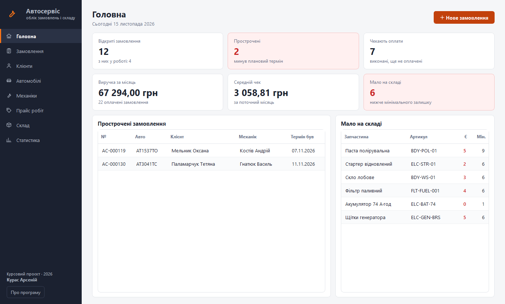

*Рисунок 4.1 — Головна сторінка з показниками*

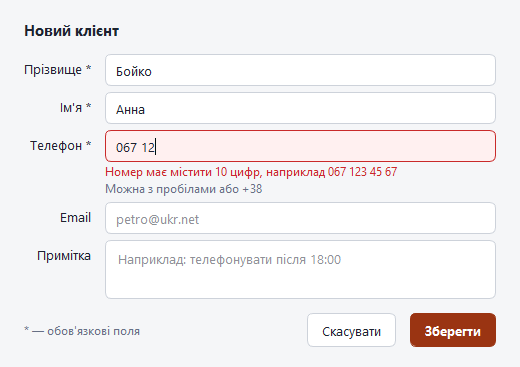

*Рисунок 4.2 — Помилка формату телефону у формі клієнта*

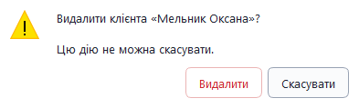

*Рисунок 4.3 — Підтвердження видалення клієнта*

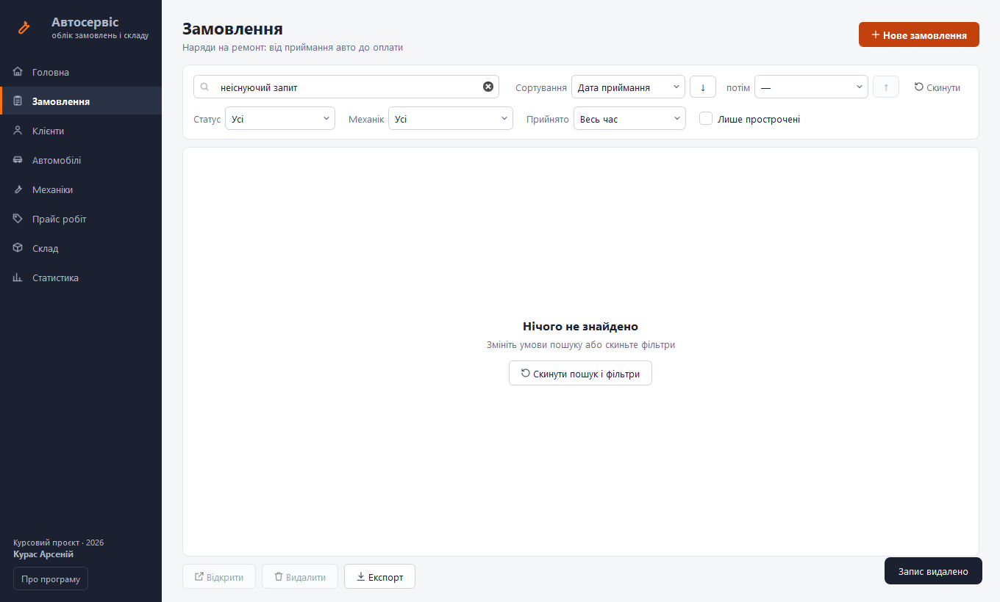

*Рисунок 4.4 — Порожній результат пошуку*

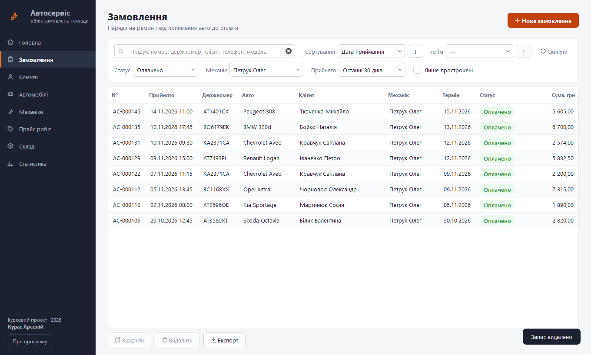

*Рисунок 4.5 — Замовлення: три фільтри одночасно*

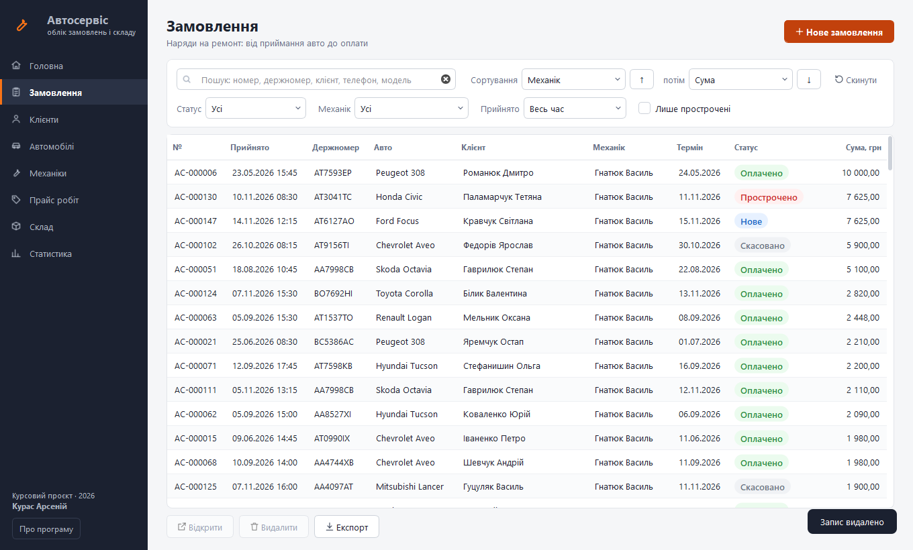

*Рисунок 4.6 — Сортування: механік за зростанням, сума за спаданням*

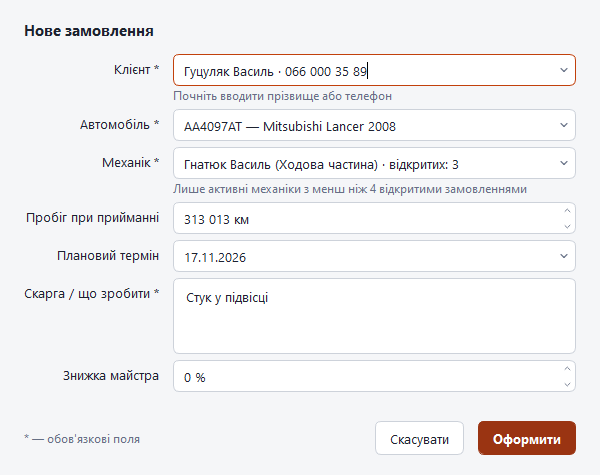

*Рисунок 4.7 — Форма нового замовлення*

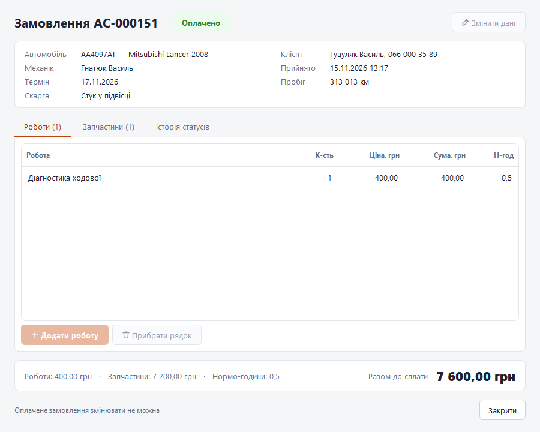

*Рисунок 4.8 — Оплачене замовлення: зміни заблоковано*

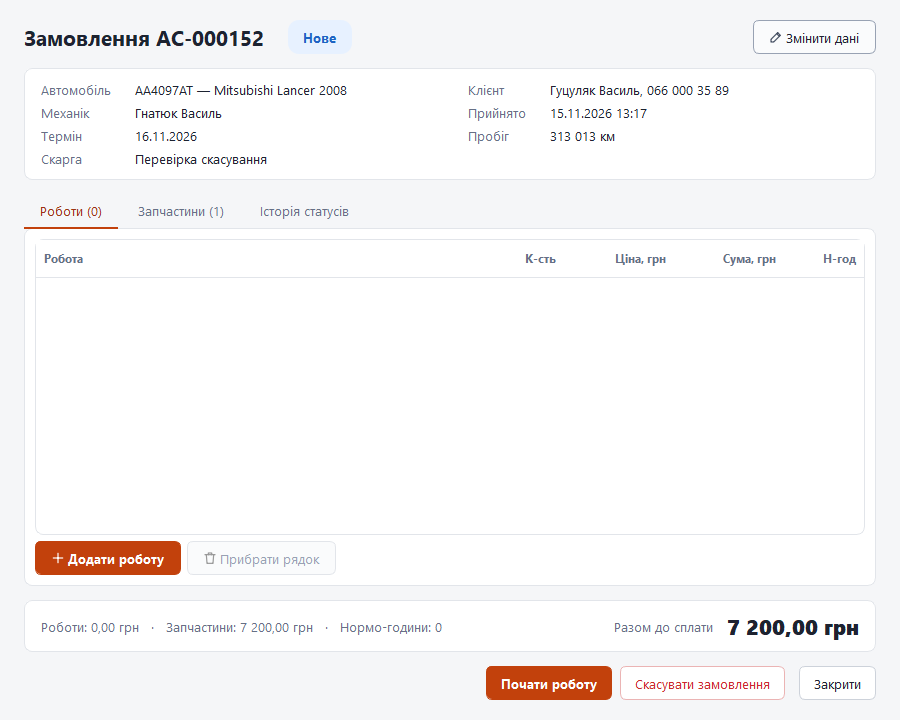

*Рисунок 4.9 — Вікно замовлення*

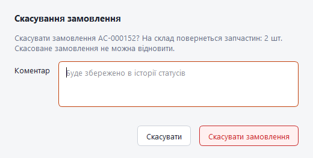

*Рисунок 4.10 — Підтвердження скасування з коментарем*

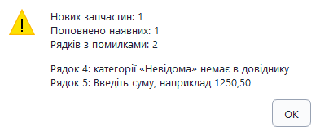

*Рисунок 4.11 — Звіт імпорту накладної*

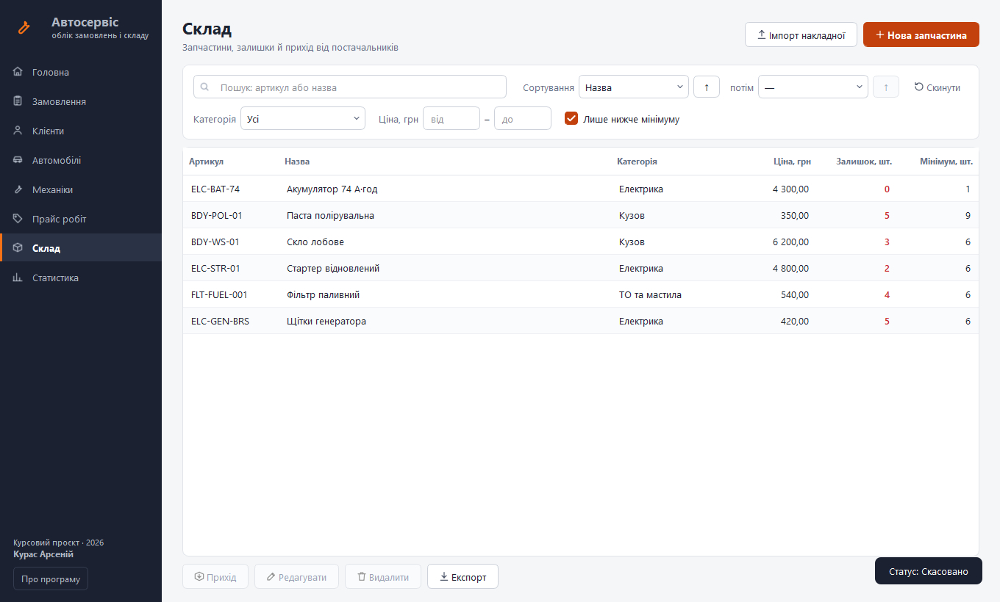

*Рисунок 4.12 — Склад: лише запчастини нижче мінімуму*

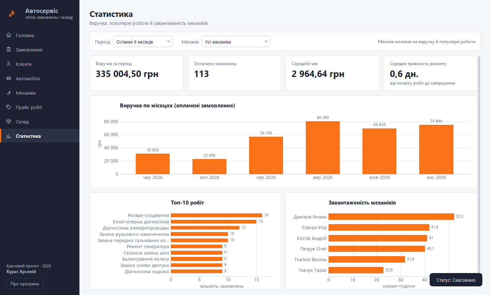

*Рисунок 4.13 — Статистика й графіки Matplotlib*

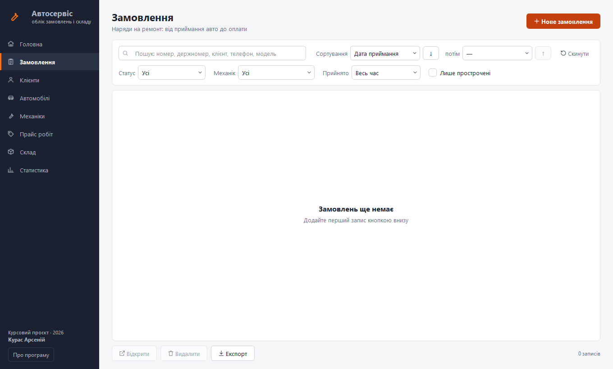

*Рисунок 4.14 — Порожня база даних*
